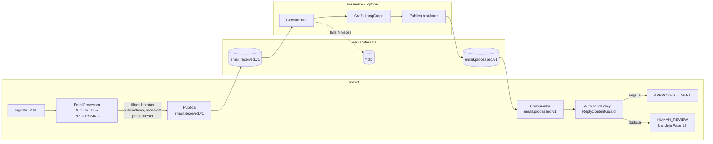
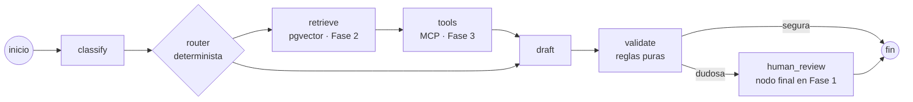
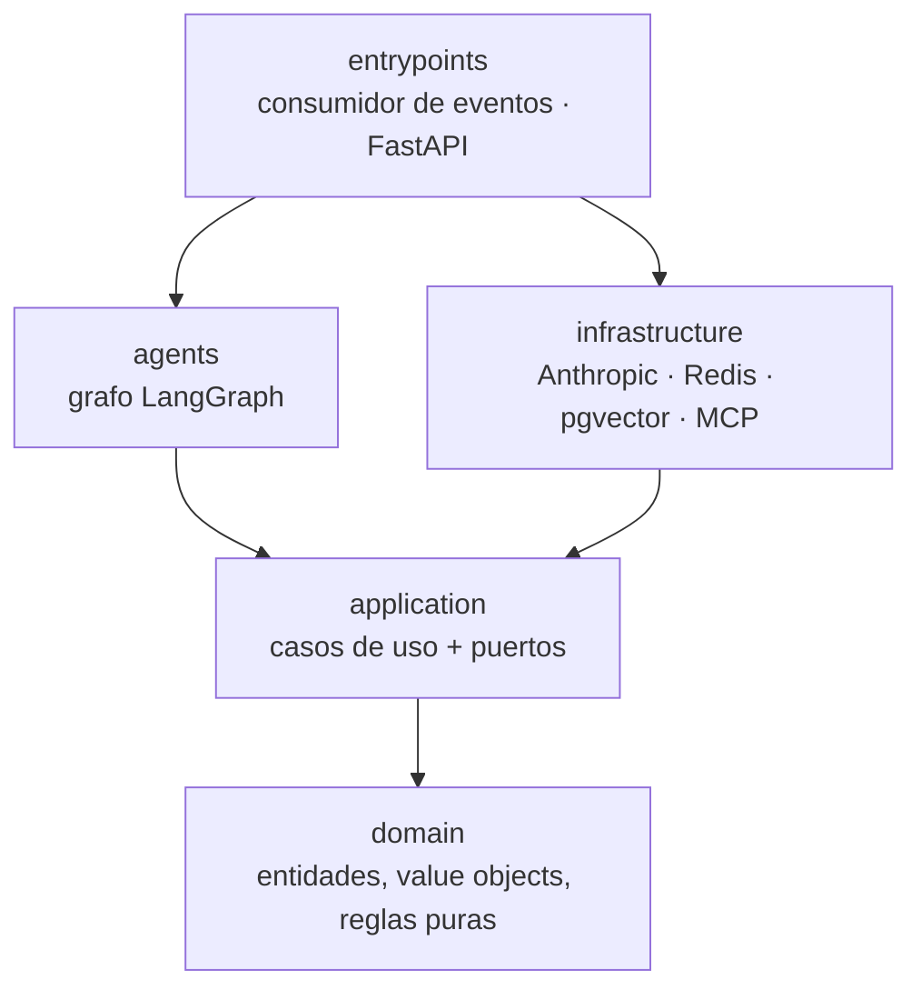

# ai-service: el cerebro de IA de la plataforma

Microservicio en **Python** que decide qué hacer con cada email: lo
clasifica, consulta la documentación y los sistemas de la empresa (más
adelante), redacta una respuesta, calcula su confianza y recomienda si se
envía sola, la revisa una persona o se escala. **Laravel** sigue siendo el
dueño de todo lo demás: ingesta IMAP, empresas, usuarios, panel, estados
del email, reglas finales y envío.

> **Estado:** Fase 1, tarea 1.1 (esqueleto). Hasta que termine la Fase 1,
> Laravel sigue procesando los emails con su propio motor
> (`AI_ENGINE=laravel`, el único que existe todavía).

## Índice

1. [Por qué un microservicio](#por-qué-un-microservicio)
2. [Arquitectura](#arquitectura)
3. [Contrato de eventos](#contrato-de-eventos)
4. [Cómo ejecutarlo](#cómo-ejecutarlo)
5. [Calidad: tests, tipos y reglas de capas](#calidad-tests-tipos-y-reglas-de-capas)
6. [Observabilidad](#observabilidad)
7. [Decisiones tomadas](#decisiones-tomadas)
8. [Hoja de ruta](#hoja-de-ruta)

## Por qué un microservicio

La plataforma nació como monolito modular en Laravel (y lo sigue siendo
para todo lo que no es IA). Se separa solo la IA porque:

- **El ecosistema de agentes está en Python** (LangGraph, SDK de MCP,
  evaluación de modelos): construirlo en PHP es ir a contracorriente.
- **Carga distinta:** una llamada a Claude tarda segundos y cuesta dinero;
  escala por número de emails, no por peticiones web. Separado, se escala y
  se limita por su cuenta (réplicas del consumidor, presupuesto).
- **Frontera clara:** Laravel publica un evento y recibe un resultado. El
  servicio de IA no toca las tablas de Laravel ni envía correos, así que un
  fallo de la IA nunca puede enviar algo que las reglas de Laravel no
  aprueben.

Lo que **no** se separa: estados, panel, envío, auditoría, revisión humana.
Ahí Laravel ya funciona y está probado.

## Arquitectura

### Flujo completo (objetivo)



### Grafo de LangGraph



En la Fase 1 el camino es `classify → draft → validate`. `human_review` es
un **nodo final** que publica la decisión: la revisión la hace una persona
en el panel de Laravel (ver [decisiones](#decisiones-tomadas)).

### Capas (arquitectura hexagonal + DDD)



| Carpeta | Qué contiene | Puede depender de |
|---|---|---|
| `domain/` | `Email`, `Classification`, `Confidence`, `Decision` y las reglas de negocio (p. ej. confianza < 0,85 → revisión humana) | Nada: solo la biblioteca estándar |
| `application/` | Casos de uso y **puertos** (`LLMPort`, `VectorStorePort`, `ToolPort`, `EventBusPort`) | `domain` |
| `agents/` | Grafo de LangGraph; usa los puertos, nunca un adaptador concreto | `application`, `domain` |
| `infrastructure/` | **Adaptadores**: Anthropic, Redis Streams, pgvector, cliente MCP, logs, métricas | `application`, `domain` |
| `mcp_server/` | Servidor MCP con las tools de CRM, ERP y tickets (Fase 3) | `application`, `domain` |
| `entrypoints/` | Consumidor de eventos y app HTTP: aquí se conectan las piezas | Todo |

Las reglas de la tabla no son una convención: **`lint-imports`** las
comprueba en cada commit y en el CI (ver `[tool.importlinter]` en
`pyproject.toml`). Por ejemplo, si `domain/` importa Pydantic o `agents/`
importa el adaptador de Anthropic, falla.

## Contrato de eventos

Se define en la tarea 1.2 (JSON Schema en `/contracts/events/`, compartido
con Laravel). Resumen de lo acordado:

| Evento | Lo publica | Campos principales |
|---|---|---|
| `email.received.v1` | Laravel | `email_id`, `tenant_id`, `from`, `subject`, `body`, `received_at` |
| `email.processed.v1` | ai-service | `email_id`, `tenant_id`, `category`, `draft`, `confidence`, `decision` (`auto_send` \| `human_review` \| `escalate`), `tools_used`, `language`, `reasons`, `model`, `usage` |
| `email.processing_failed.v1` | ai-service | `email_id`, `tenant_id`, `error_code`, `message`, `retryable` |

Todos llevan un sobre común: `event_id` (idempotencia: Redis Streams
entrega *al menos una vez*), `event_type`, `event_version`, `occurred_at` y
`trace_id` (el mismo `request_id` de Laravel, para seguir un email en Loki
de punta a punta). Añadir campos opcionales no rompe la v1; quitar o
renombrar exige v2.

## Cómo ejecutarlo

Requisitos: [uv](https://docs.astral.sh/uv/) (instala él mismo Python 3.12).

```bash
cd ai-service
uv sync                      # crea .venv con dependencias exactas (uv.lock)
uv run ai-service-http       # app HTTP en http://localhost:8000
curl localhost:8000/health   # {"status":"ok","service":"ai-service",...}
curl localhost:8000/metrics  # formato Prometheus
```

En Docker Compose se añade en la tarea 1.10.

### Configuración

Variables de entorno con prefijo `AI_SERVICE_` (o un `.env` en esta
carpeta). Valores no válidos hacen fallar el arranque, nunca se ignoran.

| Variable | Por defecto | Para qué |
|---|---|---|
| `AI_SERVICE_ENVIRONMENT` | `local` | `local`, `testing` o `production` (en producción no hay `/docs`) |
| `AI_SERVICE_LOG_LEVEL` | `INFO` | `DEBUG`, `INFO`, `WARNING`, `ERROR`, `CRITICAL` |
| `AI_SERVICE_HTTP_HOST` | `0.0.0.0` | Interfaz de la app HTTP (dentro del contenedor) |
| `AI_SERVICE_HTTP_PORT` | `8000` | Puerto de la app HTTP |

### Endpoints HTTP

FastAPI **no procesa emails** (eso lo hace el consumidor de eventos): solo
sirve para operar el servicio.

| Ruta | Para qué |
|---|---|
| `GET /health` | *Liveness*: el proceso responde (Kubernetes lo reinicia si falla) |
| `GET /metrics` | Métricas Prometheus |
| `GET /docs` | Documentación OpenAPI (no en producción) |

`/ready` (Redis disponible) llega con el consumidor en la tarea 1.7 y
`/debug/classify` con el grafo en la tarea 1.6.

## Calidad: tests, tipos y reglas de capas

```bash
uv run pytest               # tests
uv run ruff check .         # lint (incluye reglas de seguridad de bandit)
uv run ruff format --check .
uv run mypy                 # tipos en modo estricto (src y tests)
uv run lint-imports         # reglas de la arquitectura hexagonal
```

- `tests/unit/`: sin red ni servicios.
- `tests/integration/`: piezas reales conectadas (app HTTP, y más adelante
  Redis y PostgreSQL de verdad, como el CI de Laravel).
- **El LLM siempre se simula en los tests**: nunca se llama a la API real
  en el CI.

## Observabilidad

- **Logs:** JSON, una línea por entrada, a stdout. Campos: `timestamp`
  (UTC), `level` (en mayúsculas, como `level_name` de Laravel, para filtrar
  igual en Grafana), `logger`, `service`, `message` y los datos de cada
  línea. Durante el procesamiento de un email se añaden `trace_id`,
  `tenant_id` y `email_id` a todas las líneas (`bind_context`). Los logs de
  uvicorn y de otras bibliotecas también salen en JSON.
- **Métricas:** prefijo `aiservice_`, en `/metrics`. De momento
  `aiservice_build_info` y las del proceso (CPU, memoria, GC); cada tarea
  añade las suyas.

## Decisiones tomadas

| Decisión | Alternativas | Por qué |
|---|---|---|
| **uv** para dependencias | pip + venv, Poetry | Un solo binario, `uv.lock` reproducible, muy rápido en CI y en Docker |
| Paquete en `src/ai_service` | Carpeta plana | Los tests importan el paquete instalado, no archivos sueltos: detecta errores de empaquetado |
| **structlog** sobre la biblioteca estándar | `python-json-logger`, solo stdlib | Contexto por tarea con `contextvars` (`trace_id` en todas las líneas sin pasarlo a mano) y JSON también para uvicorn |
| Registro de métricas **propio** por app | Registro global de `prometheus_client` | Tests aislados, sin "métrica duplicada" |
| **import-linter** para las capas | Revisión manual | La arquitectura hexagonal se rompe en silencio; así falla el CI |
| mypy **estricto** con plugin de Pydantic, también en los tests | Solo `src`, modo normal | Los tests son código: un fake mal tipado oculta errores |
| FastAPI solo para operar | Endpoint de procesamiento HTTP | El trabajo entra por eventos (desacoplado, con reintentos); HTTP síncrono acoplaría Laravel a la latencia de Claude |

Decisiones de diseño acordadas para las siguientes tareas:

- **Laravel tiene la última palabra sobre el envío.** La `decision` de
  Python es una recomendación: Laravel la pasa por `AutoSendPolicy` y
  `ReplyContentGuard` (modo de la empresa, intenciones permitidas,
  anti-bucles, límites por remitente), que Python no conoce. Defensa en
  profundidad.
- **`email.received.v1` se publica tras los filtros baratos** de Laravel
  (correos automáticos, empresa en modo `off`, presupuesto agotado): nunca
  se paga IA por ellos.
- **`usage` y `model` en el evento**: Laravel registra cada uso en
  `ai_requests`, del que dependen los costes en Grafana y el freno de
  gasto diario. Python no escribe en tablas de Laravel.
- **`human_review` es un nodo final en la Fase 1.** El `interrupt` de
  LangGraph + checkpointing llega en la Fase 4 para lo que sí lo necesita:
  reprocesar con una indicación de la persona y aprobar tools que
  modifican datos. Si se interrumpiera en cada revisión, quedarían miles de
  hilos suspendidos que nadie reanuda (con datos personales).

## Hoja de ruta

| Fase | Contenido | Estado |
|---|---|---|
| 1 | Camino mínimo: evento → classify → draft → validate → evento → Laravel actualiza el estado | 🚧 Tarea 1.1 hecha |
| 2 | RAG con pgvector (rol de solo lectura, RLS por empresa) | Pendiente |
| 3 | Servidor MCP (CRM, ERP, tickets simulados) y tools | Pendiente |
| 4 | Checkpointing, `interrupt` y límites del agente | Pendiente |
| 5 | Supervisor con subagentes y modo *shadow* (comparar con el motor de Laravel) | Pendiente |
| 6 | Kubernetes (probado en kind) | Pendiente |
